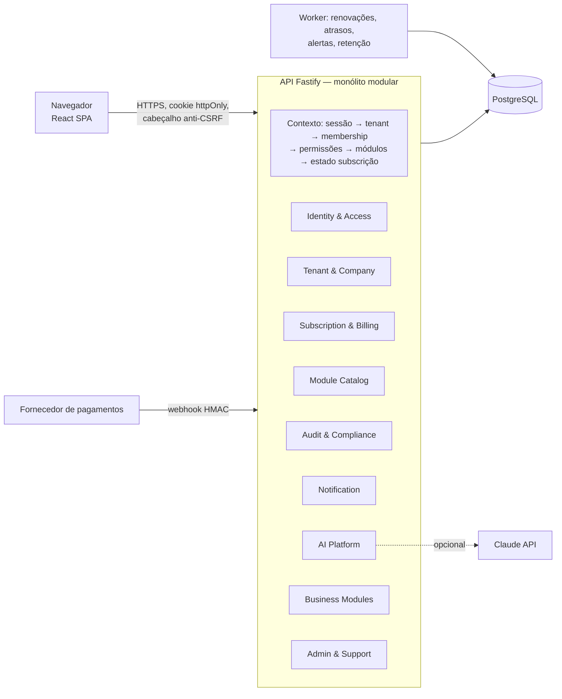

# Arquitetura da Nexora

## Visão geral

Cada pedido passa por `contextHook` (CSRF + resolução da sessão) e cada rota chama
`requireCtx()` + `authorize(ctx, permissão)`. `authorize` verifica, por esta ordem:
permissão existente → módulo contratado → permissão efetiva (funções válidas, ajustes, âmbito de
administrador) → capacidade do estado da subscrição (leitura/escrita/exportação/faturação).

## Domínios de backend (`apps/api/src`)

| Domínio | Ficheiros |
| --- | --- |
| Identity & Access | `modules/auth.routes.ts`, `core/context.ts`, `core/crypto.ts`, `core/permissions.ts` |
| Tenant & Company | `core/tenantService.ts`, `modules/company.routes.ts` |
| Subscription & Billing | `core/subscription.ts` (regras puras), `modules/billing.routes.ts` |
| Module Catalog | tabela `module_catalog`, `modules/public.routes.ts`, portal admin |
| Audit & Compliance | `core/audit.ts`, `modules/governance.routes.ts` (auditoria, lixeira, exportação, suporte) |
| Notification | `core/notify.ts` |
| AI Platform | `ai/orchestrator.ts`, `ai/tools.ts`, `ai/providers.ts`, `ai/predict.ts`, `ai/ai.routes.ts` |
| Business Modules | `modules/business.routes.ts` |
| Admin & Support | `modules/admin.routes.ts` |
| Jobs | `jobs/jobs.ts`, `worker.ts` |

## Modelo de dados (ERD)

```mermaid
erDiagram
  TENANTS ||--o{ MEMBERSHIPS : tem
  USERS ||--o{ MEMBERSHIPS : pertence
  TENANTS ||--o{ ROLES : define
  MEMBERSHIPS ||--o{ MEMBERSHIP_ROLES : recebe
  ROLES ||--o{ MEMBERSHIP_ROLES : atribuida
  MEMBERSHIPS ||--o{ PERMISSION_OVERRIDES : ajusta
  USERS ||--o{ SESSIONS : abre
  TENANTS ||--|| SUBSCRIPTIONS : subscreve
  PLANS ||--o{ SUBSCRIPTIONS : define
  TENANTS ||--o{ TENANT_MODULES : contrata
  MODULE_CATALOG ||--o{ TENANT_MODULES : oferece
  TENANTS ||--o{ INVOICES : fatura
  INVOICES ||--o{ PAYMENTS : liquida
  TENANTS ||--o{ AUDIT_EVENTS : regista
  TENANTS ||--|| AI_POLICIES : configura
  TENANTS ||--|| AI_WALLETS : saldo
  TENANTS ||--o{ AI_ACTIONS : propoe
  TENANTS ||--o{ EMPLOYEES : emprega
  MEMBERSHIPS o|--o| EMPLOYEES : conta_de
  TENANTS ||--o{ CUSTOMERS : ""
  TENANTS ||--o{ PRODUCTS : ""
  PRODUCTS ||--o{ STOCK_MOVEMENTS : ""
  TENANTS ||--o{ SALES_ORDERS : ""
  TENANTS ||--o{ FINANCE_TRANSACTIONS : ""
  TENANTS ||--o{ SUPPORT_ACCESS_GRANTS : autoriza
  TENANTS ||--o{ EXPORT_JOBS : exporta
```

Tabelas completas e colunas: `apps/api/src/db/schema.ts`; migrations versionadas em `apps/api/drizzle/`.

Notas:
- **Funcionário ≠ utilizador**: `employees` (cadastro, limite `max_employees`) e `memberships`
  (contas com acesso, limite `max_users`) são independentes; `memberships.employee_id` liga-os.
- Utilizadores podem pertencer a várias empresas (memberships múltiplas); cada sessão fixa um tenant.
- Estados de atraso (tolerância/somente leitura/suspensa) são **derivados** de faturas vencidas em
  `core/subscription.ts`, evitando estados inconsistentes; `subscriptions.status` guarda o ciclo de vida.
- Eliminação de negócio é lógica (`deleted_at`) → lixeira; purga definitiva pelo worker após o prazo,
  nunca para movimentos financeiros (retenção legal).
